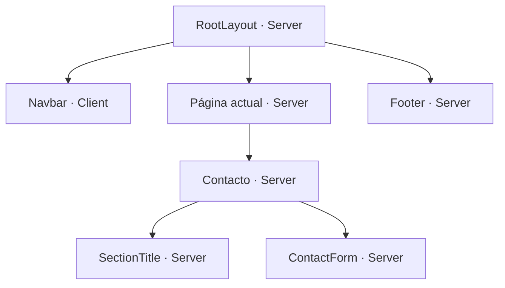

# IKOMI Perú — Proyecto académico

Sitio web desarrollado con Next.js, App Router, TypeScript y Tailwind CSS para el curso de Desarrollo de Aplicaciones Web Avanzado.

## Requisitos

- Node.js compatible con la versión de Next.js del proyecto.
- npm.
- Git.

## Instalar el proyecto

Clonar el repositorio:

```bash
git clone https://github.com/Robinson-25/ikomi-next-biktu.git
```

Entrar a la carpeta:

```bash
cd ikomi-next-biktu
```

Instalar las dependencias:

```bash
npm install
```

## Ejecutar en desarrollo

```bash
npm run dev
```

Abrir http://localhost:3000 en el navegador.
Si ese puerto está ocupado, usar la dirección que indique la terminal.

## Compilar y ejecutar en producción

Crear la compilación:

```bash
npm run build
```

Después de compilar correctamente:

```bash
npm run start
```

## Organización del proyecto

| Carpeta o archivo | Función |
|---|---|
| src/app | Páginas y rutas del sitio |
| src/app/layout.tsx | Diseño compartido con Navbar y Footer |
| src/app/page.tsx | Página de inicio |
| src/app/globals.css | Estilos y colores generales |
| src/components | Componentes reutilizables |
| src/data | Datos de los productos |
| public/images | Imágenes del sitio |
| evidencias | Capturas de las pruebas |
| DECISIONES.md | Decisiones y justificaciones |
| BITACORA_IA.md | Registro del uso de inteligencia artificial |

## Árbol de componentes implementado



La página actual cambia según la ruta visitada. El diagrama muestra
el contenido implementado para la ruta /contacto.

Navbar es Client Component porque utiliza usePathname para identificar
la ruta actual y useState para abrir y cerrar el menú móvil.

Footer, SectionTitle y ContactForm son Server Components.
El formulario es solo una interfaz: no envía ni guarda mensajes.

## Componentes preparados para integrar

| Componente | Tipo | Uso previsto |
|---|---|---|
| Hero | Server | Banner de la página de inicio |
| ProductCard | Server | Tarjetas del catálogo, con datos recibidos por props |

## Estado del proyecto

Avance inicial con componentes reutilizables, estilos compartidos,
layout y página de contacto.

Pendiente:
- Completar el contenido de las demás páginas.
- Integrar imágenes y datos reales.
- Conectar Hero y ProductCard con las páginas.
- Completar la ruta dinámica de productos.
- Verificar la compilación y el diseño responsive.
- Agregar evidencias, decisiones y bitácora de IA.

El árbol de componentes se actualizará conforme avance el proyecto.